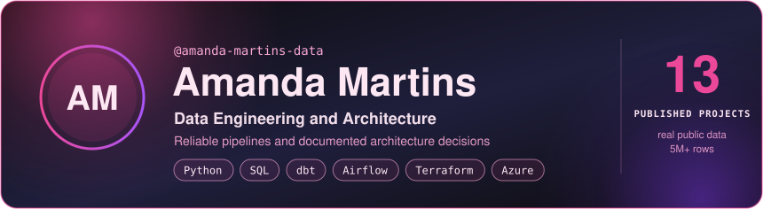
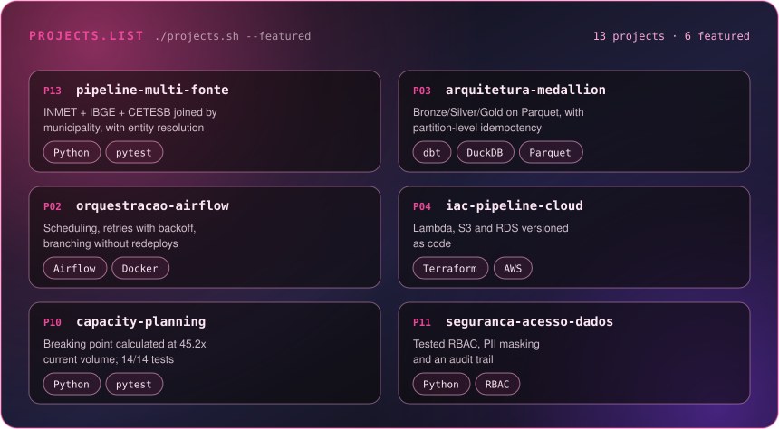
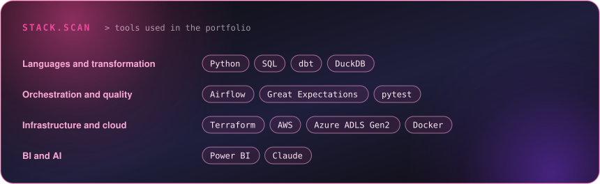

[Português](README.md) | **English**

<p align="center"></p>

<p align="center">
<a href="https://www.linkedin.com/in/amandamartinsdts/"></a>
<a href="mailto:amanda_mdantas@outlook.com"></a>
</p>

## 01 / In 30 seconds

```python
class AmandaMartins:
    def __init__(self):
        self.experience   = "6+ years in Data"
        self.role         = "Data Engineering & Architecture"
        self.focus_areas  = ["Data Pipelines", "Data Architecture", "Data for AI"]
        self.stack        = ["Python", "SQL", "dbt", "Airflow", "DuckDB", "Terraform", "Azure/AWS"]
        self.education    = "Post-Graduate in Data Architecture, PUC Minas"
```

| | |
|---|---|
| **What I do** | I design and maintain ELT pipelines, data layers (Bronze/Silver/Gold) and the governance around them |
| **Differentiator** | In every project I record the decisions I made, the limitations and the trigger for revisiting them. The mistakes I found along the way are documented too |
| **Projects** | 13 published. In the latest one I worked with real public data: 594 INMET weather stations, 5,570 IBGE municipalities and CETESB air quality readings |
| **Looking for** | Data Engineer (Mid-level) or Analytics Engineer |

## 02 / Three pillars

<table>
<tr>
<td valign="top" width="33%"><h3>🏛 Architecture with documented decisions</h3>The solution that fits the stage of the problem, with the trigger to change it recorded.<br><br><sub>Projects <a href="https://github.com/amanda-martins-data/adr-arquitetura-dados">07</a> · <a href="https://github.com/amanda-martins-data/blueprint-arquitetura-corporativa">09</a> · <a href="https://github.com/amanda-martins-data/capacity-planning-qualidade-ar">10</a></sub></td>
<td valign="top" width="33%"><h3>🧰 Reliable pipelines over heterogeneous sources</h3>Orchestration, idempotency, data tests and entity resolution on messy data.<br><br><sub>Projects <a href="https://github.com/amanda-martins-data/pipeline-qualidade-ar">01</a> · <a href="https://github.com/amanda-martins-data/orquestracao-airflow-qualidade-ar">02</a> · <a href="https://github.com/amanda-martins-data/arquitetura-medallion-qualidade-ar">03</a> · <a href="https://github.com/amanda-martins-data/pipeline-multi-fonte-dados-publicos">13</a></sub></td>
<td valign="top" width="33%"><h3>🚀 Data for AI</h3>AI applied to data quality checks; RAG pipeline and MCP server on the Gold layer in progress.<br><br><sub>Project <a href="https://github.com/amanda-martins-data/ai-pipeline-qualidade-ar">05</a></sub></td>
</tr>
</table>

## 03 / Project district

<p align="center"></p>

The documentation inside each repository is currently in Portuguese.

### Pipelines and data layers

| # | Project | What it delivers | Stack |
|---|---|---|---|
| 01 | [ELT pipeline with dbt](https://github.com/amanda-martins-data/pipeline-qualidade-ar) | OpenAQ ingestion, dimensional modeling and declarative tests | `Python` `dbt` `DuckDB` |
| 02 | [Airflow orchestration](https://github.com/amanda-martins-data/orquestracao-airflow-qualidade-ar) | Scheduling, retries with backoff, alerts and branching without redeploys | `Airflow` `Docker` |
| 03 | [Medallion architecture](https://github.com/amanda-martins-data/arquitetura-medallion-qualidade-ar) | Bronze/Silver/Gold on Parquet, idempotency through partition rewrite | `Parquet` `dbt` |
| 13 | [Multi-source pipeline](https://github.com/amanda-martins-data/pipeline-multi-fonte-dados-publicos) | INMET + IBGE + CETESB joined by municipality, with layered entity resolution | `Python` `pytest` |

### Architecture, governance and security

| # | Project | What it delivers | Stack |
|---|---|---|---|
| 07 | [Architecture ADRs](https://github.com/amanda-martins-data/adr-arquitetura-dados) | Decision records with context, alternatives and a trigger for revisiting each one | `ADR` |
| 08 | [Governance and catalog](https://github.com/amanda-martins-data/governanca-catalogo-dados) | Roles, RACI, retention and classification mapped to LGPD (the Brazilian data protection law); a catalog generated from YAML, with verified lineage | `Python` `YAML` |
| 09 | [Corporate blueprint](https://github.com/amanda-martins-data/blueprint-arquitetura-corporativa) | Conceptual, logical and physical models, data flow and non-functional requirements for a fictional organization, with no code | `Architecture` |
| 10 | [Capacity planning](https://github.com/amanda-martins-data/capacity-planning-qualidade-ar) | Where each component of the Project 04 infrastructure breaks at 10x and 100x, with a tested cost model and a re-architecture plan | `Python` |
| 11 | [Security and access](https://github.com/amanda-martins-data/seguranca-acesso-dados) | Tested RBAC on top of the Project 08 catalog, PII masking and an audit trail | `Python` |

### Quality, AI and infrastructure

| # | Project | What it delivers | Stack |
|---|---|---|---|
| 04 | [IaC for a cloud pipeline](https://github.com/amanda-martins-data/iac-pipeline-cloud-qualidade-ar) | Lambda, S3 and RDS versioned as code | `Terraform` `AWS` |
| 05 | [Pipeline with integrated AI](https://github.com/amanda-martins-data/ai-pipeline-qualidade-ar) | AI agent for data quality checks and documentation | `Claude` `LLMs` |
| 06 | [Observability and quality](https://github.com/amanda-martins-data/observabilidade-qualidade-ar) | Data tests and quality monitoring | `Great Expectations` |
| 12 | [Event-driven streaming](https://github.com/amanda-martins-data/streaming-qualidade-ar) | In-memory schema registry and event bus with tested guarantees, and a batch vs streaming latency model | `Python` |

<h3 align="center"><a href="https://github.com/amanda-martins-data?tab=repositories">Explore the repositories ↗</a></h3>

## 04 / Stack

<p align="center"></p>

## 05 / Highlighted technical decisions

Five decisions I made, each with its trade-off and rationale recorded in the repository.

- **Parquet with dbt reading and writing the files directly (Project 03).** The same file serves DuckDB, Spark or pandas without reprocessing. I gave up the indexes and native access control of a warehouse, and I recorded the trigger for revisiting the decision.
- **Idempotency through partition rewrite (Project 03).** In Silver I delete and rewrite each affected partition, so running the transformation twice gives the same result. This method gets expensive at high volume, and the project README says so.
- **Layered entity resolution (Project 13).** I found that 9.4% of Brazilian municipalities cannot be reached by name alone. I resolve from the strongest evidence to the weakest, and whatever stays ambiguous goes to quarantine: 100% resolution with name and state, 90.6% with name only.
- **Streaming without a cluster (Project 12).** In ADR 0010 I decided to stay with batch. To be ready when one of the triggers appears, I implemented and tested the guarantees that would matter (partitioning, at-least-once delivery and schema compatibility), without provisioning Kafka.
- **A wrong assumption of mine (Project 11).** A test showed that I had misunderstood the `data_consumer` role and internal datasets. The failure was in the test, and I fixed it and documented the correct semantics.

## 06 / How to read my repositories

In each repository I describe the problem, the architecture and the limitations, and I record the decisions and the known gaps. There are instructions to run everything from scratch.

Continuous integration runs on GitHub Actions, with a status badge in the README. Eight repositories run their tests on every change (04, 05, 06, 08, 10, 11, 12 and 13), and three check the Python syntax and run `dbt parse` (01, 02 and 03). Projects 07 and 09 are documentation only and have no CI.

## 07 / In progress

- **Data for AI:** a RAG pipeline treated as data engineering (ingestion, chunking, an index with incremental refresh, retrieval quality) and an MCP server on top of the Gold layer, using the access control from Project 11.
- **Lakehouse at scale:** a version of Project 03 with Spark and a Delta or Iceberg table format, covering schema evolution and compaction.
- **Azure and a cloud warehouse:** the Project 04 infrastructure on Azure and the same dbt model running on BigQuery or Snowflake.
- **Data contracts:** extending the catalog contract (Project 08) to validate the sources in Project 13.


---

<h2 align="center">The next block starts with a conversation.</h2>

<p align="center">
<a href="https://www.linkedin.com/in/amandamartinsdts/"></a>
<a href="mailto:amanda_mdantas@outlook.com"></a>
</p>

<p align="center"><sub>Amanda Martins · layout inspired by the <a href="https://www.gitskins.com/readme-generator?template=community-builder-s-workbench-city-edition-9udn">Builder’s Workbench — City Edition</a> template by <a href="https://www.gitskins.com/creators/pengusto">@pengusto</a> on GitSkins</sub></p>
