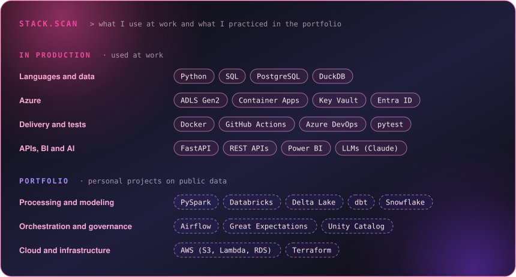
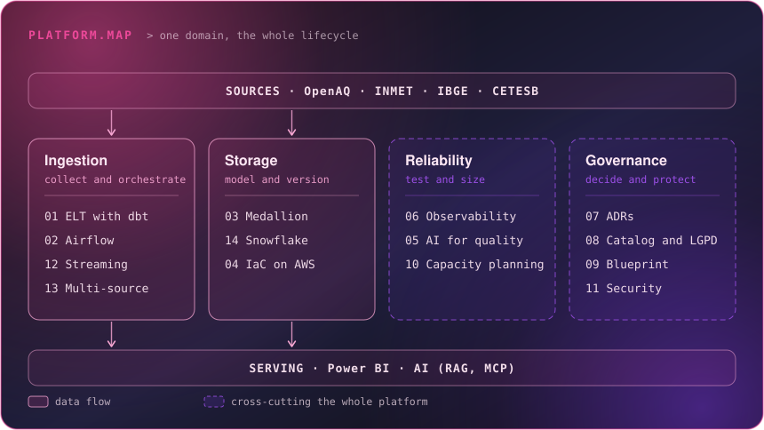

[Português](README.md) | **English**

Data engineer. **At work**, I build production pipelines on Azure. **In my portfolio**, with personal projects on public data, I practice what I don't use day to day yet: a complete platform around one domain, from ingestion to governance, and a lakehouse on Databricks. Looking for **Data Engineering** or **Analytics Engineering** roles, remote or hybrid.

## 01 / Experience: in production

**CPEA** · Mid-level Data Analyst, Data Engineering (Oct 2025 – present)

- Python pipelines serving **5 business areas**, from REST APIs (including ArcGIS) to ADLS Gen2 and DuckDB; **30% less execution time** in one of the processes.
- End-to-end data applications (PostgreSQL, FastAPI, Docker) on Azure Container Apps, deployed through OIDC with **zero secrets** in the repositories.
- Rolled out Azure DevOps for the team's agile delivery and ran internal trainings, including data architecture for IT.

Before: 5 years in data analysis and BI, across education, aviation and mobility. Lean Six Sigma Green Belt.

## 02 / Stack

What is **in production** I use at work; what is **portfolio** I practiced in the projects below.

## 03 / Portfolio: the platform

Personal projects on real public data; not client work. Fourteen of them form a platform around one domain, air quality and climate in Brazil: each project solves one layer, and the decisions made in one show up in the next. The fifteenth takes the same design to a new domain, payments, on Databricks.

## 04 / Portfolio: case studies

<table>
<tr>
<td width="50%" valign="top">

**[Keys that don't match](https://github.com/amanda-martins-data/pipeline-multi-fonte-dados-publicos)** 
Project 13 · Python · DuckDB

**Problem:** three public sources with no common key.

**Finding:** 9.4% of Brazilian municipalities can't be reached by name alone, and stripping accents creates 8 new collisions.

**Decision:** resolve by name + state, with coordinates only as supporting evidence ([ADR 0012](https://github.com/amanda-martins-data/pipeline-multi-fonte-dados-publicos/blob/main/decisions/0012-estrategia-para-municipios-sem-correspondencia.md)).

**Result:** 5M+ rows joined by municipality, 100% resolved with name and state.

</td>
<td width="50%" valign="top">

**[Same architecture, two engines](https://github.com/amanda-martins-data/snowflake-medallion-qualidade-ar)** 
Projects 03 and 14 · dbt · Snowflake

**Problem:** reprocess without duplicates, then take the design to the cloud.

**Decision:** the same Medallion on Parquet + DuckDB and natively on Snowflake, with `COPY INTO`, Bronze in `VARIANT` and an incremental Silver with `MERGE`.

**Result:** idempotent reruns in both versions; 16/16 models and tests on Snowflake, with least-privilege roles.

</td>
</tr>
<tr>
<td width="50%" valign="top">

**[When the architecture breaks](https://github.com/amanda-martins-data/capacity-planning-qualidade-ar)** 
Project 10 · Python · AWS

**Problem:** know how far the AWS infrastructure (Lambda, S3, RDS) can go.

**Decision:** a capacity and cost model parameterized by volume, with tests.

**Result:** Lambda breaks at 45.2x the current volume; the expected 10x growth runs in 203 s, a quarter of the limit.

</td>
<td width="50%" valign="top">

**[The source doesn't tell everything](https://github.com/amanda-martins-data/lakehouse-pix-databricks)** 
Project 15 · PySpark · Databricks · Delta Lake

**Problem:** load Pix payments by municipality since 2020 and reprocess recent months without duplicates.

**Finding:** the API's date parameter means "from this month on", not "this month"; and a row with no municipality, worth billions, would duplicate on every `MERGE` because its key is null.

**Decision:** Auto Loader in Bronze, `MERGE` on a surrogate key in Silver, and a Job versioned as a Databricks Asset Bundle.

**Result:** 406,591 rows over 73 months, Bronze, Silver and Gold reconciled, and reruns without duplicates.

</td>
</tr>
</table>

<b>All 15 portfolio projects, one by one</b>

| # | Project | Delivers |
|---|---|---|
| 01 | [ELT pipeline with dbt](https://github.com/amanda-martins-data/pipeline-qualidade-ar) | Public API ingestion, dimensional model and declarative tests |
| 02 | [Airflow orchestration](https://github.com/amanda-martins-data/orquestracao-airflow-qualidade-ar) | DAG with retries, alerts and branching |
| 03 | [Medallion architecture](https://github.com/amanda-martins-data/arquitetura-medallion-qualidade-ar) | Bronze/Silver/Gold layers on Parquet |
| 04 | [IaC on AWS](https://github.com/amanda-martins-data/iac-pipeline-cloud-qualidade-ar) | Lambda, S3 and RDS in Terraform |
| 05 | [Pipeline with AI](https://github.com/amanda-martins-data/ai-pipeline-qualidade-ar) | AI agents for data quality and documentation |
| 06 | [Observability](https://github.com/amanda-martins-data/observabilidade-qualidade-ar) | Great Expectations plus freshness and completeness checks |
| 07 | [ADRs](https://github.com/amanda-martins-data/adr-arquitetura-dados) | Architecture decisions with alternatives and a review trigger |
| 08 | [Governance and catalog](https://github.com/amanda-martins-data/governanca-catalogo-dados) | RACI, retention, LGPD classification and a catalog with lineage |
| 09 | [Corporate blueprint](https://github.com/amanda-martins-data/blueprint-arquitetura-corporativa) | Conceptual, logical and physical models and non-functional requirements |
| 10 | [Capacity planning](https://github.com/amanda-martins-data/capacity-planning-qualidade-ar) | Breaking points at 10x and 100x, with a tested cost model |
| 11 | [Security and access](https://github.com/amanda-martins-data/seguranca-acesso-dados) | RBAC, PII masking and auditing |
| 12 | [Streaming](https://github.com/amanda-martins-data/streaming-qualidade-ar) | Schema registry and event bus with tested guarantees |
| 13 | [Multi-source pipeline](https://github.com/amanda-martins-data/pipeline-multi-fonte-dados-publicos) | Three public sources joined with entity resolution |
| 14 | [Medallion on Snowflake](https://github.com/amanda-martins-data/snowflake-medallion-qualidade-ar) | Native Bronze/Silver/Gold on Snowflake with dbt and RBAC |
| 15 | [Pix lakehouse on Databricks](https://github.com/amanda-martins-data/lakehouse-pix-databricks) | Medallion with PySpark, Delta Lake, Auto Loader and a Job in an Asset Bundle |

**Next steps:** a municipality dimension shared by Projects 13 and 15, closing Project 15 on Azure Databricks with Terraform, and the Databricks Data Engineer Associate certification, in preparation.

---

Amanda Martins · layout inspired by the <a href="https://www.gitskins.com/readme-generator?template=community-builder-s-workbench-city-edition-9udn">Builder’s Workbench — City Edition</a> template by <a href="https://www.gitskins.com/creators/pengusto">@pengusto</a> on GitSkins

