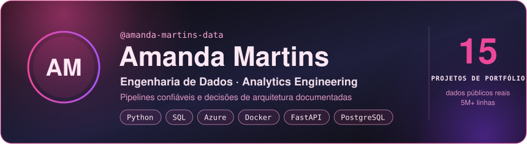
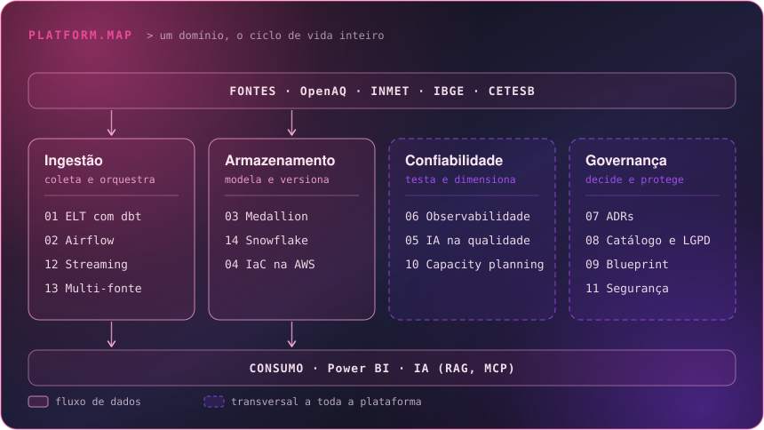
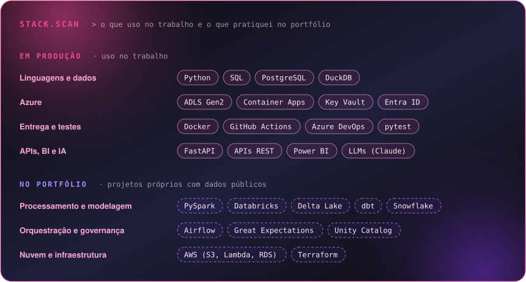

**Português** | [English](README.en.md)

Engenheira de dados. No trabalho, construo pipelines em produção no Azure; no portfólio, uma plataforma de dados completa sobre um único domínio, da ingestão à governança. Busco posições de **Engenharia de Dados** ou **Analytics Engineering**, remotas ou híbridas.

## 01 / A plataforma

Quatorze projetos, um domínio: qualidade do ar e clima no Brasil. Cada projeto resolve uma camada da plataforma, e as decisões de um aparecem no seguinte.

## 02 / Estudos de caso

<table>
<tr>
<td width="33%" valign="top">

**[Chaves que não casam](https://github.com/amanda-martins-data/pipeline-multi-fonte-dados-publicos)** 
Projeto 13 · Python · DuckDB

**Problema:** três fontes públicas sem chave em comum.

**Descoberta:** 9,4% dos municípios não são alcançáveis só pelo nome, e remover acentos cria 8 colisões novas.

**Decisão:** resolver por nome + UF, com a coordenada só como evidência auxiliar ([ADR 0012](https://github.com/amanda-martins-data/pipeline-multi-fonte-dados-publicos/blob/main/decisions/0012-estrategia-para-municipios-sem-correspondencia.md)).

**Resultado:** 5M+ linhas unidas por município, 100% de resolução com nome e UF.

</td>
<td width="33%" valign="top">

**[Mesma arquitetura, dois motores](https://github.com/amanda-martins-data/snowflake-medallion-qualidade-ar)** 
Projetos 03 e 14 · dbt · Snowflake

**Problema:** reprocessar sem duplicar e levar o desenho para a nuvem.

**Decisão:** a mesma Medallion em Parquet + DuckDB e em Snowflake nativo, com `COPY INTO`, Bronze em `VARIANT` e Silver incremental com `MERGE`.

**Resultado:** reexecução idempotente nas duas versões; 16/16 modelos e testes no Snowflake, com roles de menor privilégio.

</td>
<td width="33%" valign="top">

**[Quando a arquitetura quebra](https://github.com/amanda-martins-data/capacity-planning-qualidade-ar)** 
Projeto 10 · Python · AWS

**Problema:** saber até onde a infraestrutura na AWS (Lambda, S3, RDS) aguenta.

**Decisão:** modelo de capacidade e custo parametrizado por volume, com testes.

**Resultado:** a Lambda quebra em 45,2x o volume atual; o crescimento previsto de 10x roda em 203 s, um quarto do limite.

</td>
</tr>
</table>

## 03 / Em produção

**CPEA** · Analista de Dados Pleno, Engenharia de Dados (out/2025 – atual)

- Pipelines em Python que abastecem **5 áreas de negócio**, de APIs REST (incluindo ArcGIS) ao ADLS Gen2 e DuckDB; **−30% de tempo** de execução em um dos processos.
- Aplicações de dados ponta a ponta (PostgreSQL, FastAPI, Docker) no Azure Container Apps, com deploy por OIDC e **zero segredos** nos repositórios.
- Implantação do Azure DevOps para a entrega ágil da equipe e treinamentos internos, incluindo arquitetura de dados para a TI.

Antes: 5 anos em análise de dados e BI, em educação, aviação e mobilidade. Lean Six Sigma Green Belt.

## 04 / Stack

<b>Os 14 projetos, um a um</b>

| # | Projeto | Entrega |
|---|---|---|
| 01 | [Pipeline ELT com dbt](https://github.com/amanda-martins-data/pipeline-qualidade-ar) | Ingestão de API pública, modelo dimensional e testes declarativos |
| 02 | [Orquestração com Airflow](https://github.com/amanda-martins-data/orquestracao-airflow-qualidade-ar) | DAG com retries, alertas e ramificação |
| 03 | [Arquitetura Medallion](https://github.com/amanda-martins-data/arquitetura-medallion-qualidade-ar) | Camadas Bronze/Silver/Gold em Parquet |
| 04 | [IaC na AWS](https://github.com/amanda-martins-data/iac-pipeline-cloud-qualidade-ar) | Lambda, S3 e RDS em Terraform |
| 05 | [Pipeline com IA](https://github.com/amanda-martins-data/ai-pipeline-qualidade-ar) | Agentes de IA para qualidade e documentação de dados |
| 06 | [Observabilidade](https://github.com/amanda-martins-data/observabilidade-qualidade-ar) | Great Expectations e checagens de frescor e completude |
| 07 | [ADRs](https://github.com/amanda-martins-data/adr-arquitetura-dados) | Decisões de arquitetura com alternativas e gatilho de revisão |
| 08 | [Governança e catálogo](https://github.com/amanda-martins-data/governanca-catalogo-dados) | RACI, retenção, classificação LGPD e catálogo com linhagem |
| 09 | [Blueprint corporativo](https://github.com/amanda-martins-data/blueprint-arquitetura-corporativa) | Modelos conceitual, lógico e físico e requisitos não funcionais |
| 10 | [Capacity planning](https://github.com/amanda-martins-data/capacity-planning-qualidade-ar) | Ruptura a 10x e 100x, com modelo de custo testado |
| 11 | [Segurança e acesso](https://github.com/amanda-martins-data/seguranca-acesso-dados) | RBAC, mascaramento de PII e auditoria |
| 12 | [Streaming](https://github.com/amanda-martins-data/streaming-qualidade-ar) | Schema registry e event bus com garantias testadas |
| 13 | [Pipeline multi-fonte](https://github.com/amanda-martins-data/pipeline-multi-fonte-dados-publicos) | Três fontes públicas unidas com resolução de entidades |
| 14 | [Medallion no Snowflake](https://github.com/amanda-martins-data/snowflake-medallion-qualidade-ar) | Bronze/Silver/Gold nativo no Snowflake com dbt e RBAC |

**Em construção:** lakehouse no Azure como código (Databricks, Unity Catalog, Terraform) e dados para IA (RAG e servidor MCP sobre a camada Gold).

---

Amanda Martins · layout inspirado no template <a href="https://www.gitskins.com/readme-generator?template=community-builder-s-workbench-city-edition-9udn">Builder’s Workbench — City Edition</a>, de <a href="https://www.gitskins.com/creators/pengusto">@pengusto</a> no GitSkins

