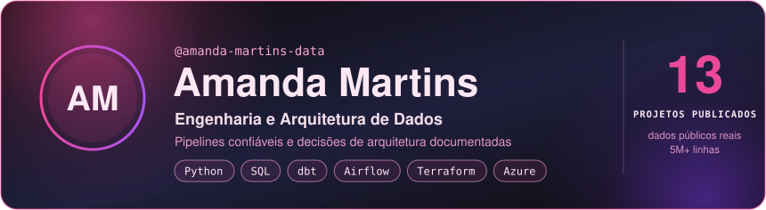
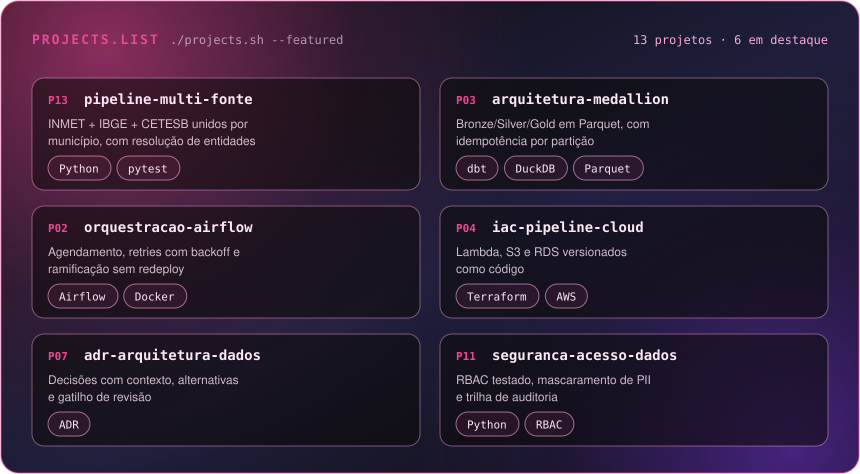
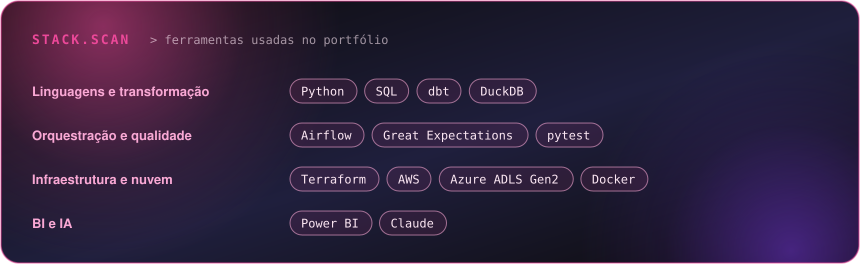

**Português** | [English](README.en.md)

Profissional de dados com 6+ anos de experiência e pós-graduação em Arquitetura de Dados (PUC Minas). Construo pipelines em Python e SQL, arquitetura em camadas no Azure e decisões de arquitetura documentadas. Busco posições de **Engenharia de Dados (Pleno)** ou **Analytics Engineering**, remotas ou híbridas.

## 01 / Resultados

**Na CPEA** · Analista de Dados Pleno, Engenharia de Dados (out/2025 – atual)

- **5 áreas de negócio atendidas** por pipelines em Python que integram APIs REST (incluindo ArcGIS) ao ADLS Gen2 e à camada analítica em DuckDB e SQL.
- **30% menos tempo de execução** ao converter um processo manual em planilhas em pipeline via API REST, gravando na camada bronze.
- **Zero segredos nos repositórios:** deploy com GitHub Actions e federação de identidade (OIDC); aplicações em Docker no Azure Container Apps, com Key Vault e Entra ID.
- **Aplicações de dados ponta a ponta:** bancos PostgreSQL com migrações versionadas e auditadas, APIs em FastAPI e integração com interfaces web.

**Organização e governança**

- Apoio a organização técnica da equipe de dados: estruturação do roadmap e gestão das entregas no Azure DevOps.
- Contribuo com a governança de IA e proteção de dados da empresa: políticas de uso, mapeamento de riscos e automações com IA (OCR e geração de relatórios).

**No portfólio público**

- **5.025.594 linhas reais** do INMET integradas a 5.570 municípios do IBGE e a leituras da CETESB.
- **100% de resolução de municípios** com nome e UF, após identificar que 9,4% não são alcançáveis só pelo nome.
- **13 projetos publicados, 11 com CI** no GitHub Actions; decisões registradas em ADRs, com alternativas e gatilho de revisão.

## 02 / Projetos em destaque

| Projeto | Problema | Resultado |
|---|---|---|
| [13 · Pipeline multi-fonte](https://github.com/amanda-martins-data/pipeline-multi-fonte-dados-publicos) | Três fontes públicas com chaves que não casam | 5M+ linhas unidas por município; 100% de resolução com nome e UF |
| [03 · Arquitetura Medallion](https://github.com/amanda-martins-data/arquitetura-medallion-qualidade-ar) | Reprocessar sem duplicar dados | Bronze/Silver/Gold em Parquet com dbt; reexecução gera o mesmo resultado |
| [02 · Orquestração com Airflow](https://github.com/amanda-martins-data/orquestracao-airflow-qualidade-ar) | Pipeline manual e sem tolerância a falhas | Agendamento, retries com backoff e alertas; troca de fonte sem redeploy |
| [04 · IaC na AWS](https://github.com/amanda-martins-data/iac-pipeline-cloud-qualidade-ar) | Infraestrutura criada à mão | Lambda, S3 e RDS versionados em Terraform |
| [10 · Capacity planning](https://github.com/amanda-martins-data/capacity-planning-qualidade-ar) | Saber quando a arquitetura quebra | Ponto de ruptura calculado em 45,2x o volume atual; 14/14 testes |
| [11 · Segurança e acesso](https://github.com/amanda-martins-data/seguranca-acesso-dados) | Controle de acesso a dados sensíveis | RBAC testado, mascaramento de PII e trilha de auditoria |

<b>Todos os 13 projetos</b>

| # | Projeto | Entrega |
|---|---|---|
| 01 | [Pipeline ELT com dbt](https://github.com/amanda-martins-data/pipeline-qualidade-ar) | Ingestão do OpenAQ, modelo dimensional e testes declarativos |
| 02 | [Orquestração com Airflow](https://github.com/amanda-martins-data/orquestracao-airflow-qualidade-ar) | DAG com retries, alertas e ramificação |
| 03 | [Arquitetura Medallion](https://github.com/amanda-martins-data/arquitetura-medallion-qualidade-ar) | Camadas Bronze/Silver/Gold em Parquet |
| 04 | [IaC na AWS](https://github.com/amanda-martins-data/iac-pipeline-cloud-qualidade-ar) | Lambda, S3 e RDS em Terraform |
| 05 | [Pipeline com IA](https://github.com/amanda-martins-data/ai-pipeline-qualidade-ar) | Agentes de IA para qualidade e documentação de dados |
| 06 | [Observabilidade](https://github.com/amanda-martins-data/observabilidade-qualidade-ar) | Great Expectations e checagens de frescor e completude |
| 07 | [ADRs](https://github.com/amanda-martins-data/adr-arquitetura-dados) | Decisões de arquitetura com alternativas e gatilho de revisão |
| 08 | [Governança e catálogo](https://github.com/amanda-martins-data/governanca-catalogo-dados) | RACI, retenção, classificação LGPD e catálogo com linhagem |
| 09 | [Blueprint corporativo](https://github.com/amanda-martins-data/blueprint-arquitetura-corporativa) | Modelos conceitual, lógico e físico e requisitos não funcionais |
| 10 | [Capacity planning](https://github.com/amanda-martins-data/capacity-planning-qualidade-ar) | Ruptura a 10x e 100x, com modelo de custo testado |
| 11 | [Segurança e acesso](https://github.com/amanda-martins-data/seguranca-acesso-dados) | RBAC, mascaramento de PII e auditoria |
| 12 | [Streaming](https://github.com/amanda-martins-data/streaming-qualidade-ar) | Schema registry e event bus com garantias testadas |
| 13 | [Pipeline multi-fonte](https://github.com/amanda-martins-data/pipeline-multi-fonte-dados-publicos) | INMET + IBGE + CETESB com resolução de entidades |

## 03 / Stack

## 04 / Em construção

- **Lakehouse no Azure como código:** ADLS Gen2, Databricks e Unity Catalog em Terraform, com jobs PySpark e Delta Lake.
- **Dados para IA:** pipeline de RAG e servidor MCP sobre a camada Gold, com o controle de acesso do Projeto 11.

---

Amanda Martins · layout inspirado no template <a href="https://www.gitskins.com/readme-generator?template=community-builder-s-workbench-city-edition-9udn">Builder’s Workbench — City Edition</a>, de <a href="https://www.gitskins.com/creators/pengusto">@pengusto</a> no GitSkins

